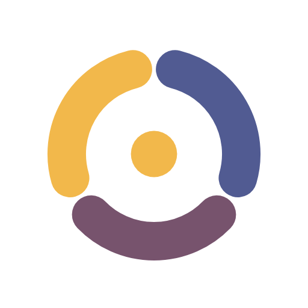

<p align="center">
  
</p>

<h1 align="center">Sirkel</h1>

<p align="center">
  Aplikasi mobile untuk belajar bareng mentor sebaya. Proyek ini mendukung <b>SDG 4: Pendidikan Berkualitas</b>.
</p>

<p align="center">
  
  
  
  
</p>

---

## 📖 Tentang Sirkel

Banyak mahasiswa kesulitan di mata kuliah tertentu tapi sungkan bertanya ke dosen. **Sirkel** mempertemukan mereka dengan **kakak tingkat (mentor sebaya)** dalam kelompok belajar kecil yang disebut *sirkel*. Pengguna bisa:

- 🔍 **Menemukan sirkel** sesuai mata kuliah yang sedang dipelajari
- 🤝 **Belajar bareng mentor sebaya** dengan bahasa yang lebih santai
- 📈 **Memantau progres**: jadwal sesi, jam belajar, dan lencana

> Aplikasi ini berfokus pada **front-end**. Semua data masih berupa *dummy data* di memori (`lib/data/dummy/`), belum terhubung ke backend.

## ✨ Fitur

| Fitur | Keterangan |
|---|---|
| **Splash & Onboarding** | Tiga halaman pengenalan dengan ilustrasi dan indikator halaman |
| **Masuk & Daftar** | Validasi form, termasuk email kampus berakhiran `.ac.id` |
| **Beranda** | Sesi hari ini, rekomendasi sirkel, dan badge notifikasi belum dibaca |
| **Jelajah** | Pencarian langsung, *quick chips*, filter lewat *bottom sheet*, dan grid responsif |
| **Detail Sirkel** | Info mentor, jadwal, kuota, tombol gabung, dan dialog konfirmasi |
| **Buat Sirkel** | Pilih sampul, mata kuliah, mode online/offline, hari, jam, dan kuota |
| **Sirkel Saya** | Daftar sesi yang dikelompokkan per tanggal |
| **Materi** | Ruang materi dan halaman detail materi |
| **Notifikasi** | Daftar notifikasi pengguna |
| **Profil** | Statistik belajar dan lencana |
| **Navigasi adaptif** | `NavigationBar` di HP, `NavigationRail` di layar lebar |

## 🛠️ Teknologi

- **Flutter** 3.47 dan **Dart** 3.13
- **Material 3** dengan tema kustom
- Font **Plus Jakarta Sans** (lisensi OFL)
- Tanpa package pihak ketiga, hanya `cupertino_icons`
- Testing dengan `flutter_test` (unit dan widget test)

## 🚀 Cara Menjalankan

**Prasyarat:** Flutter SDK 3.47+ sudah terpasang. Cek dengan `flutter doctor`.

```bash
git clone https://github.com/Rolexx17/SirkelKomting.git
cd SirkelKomting
flutter pub get
flutter run
```

Pilih device saat diminta: emulator Android, HP lewat USB, Chrome, atau Windows.

**Menjalankan test:**

```bash
flutter test
flutter analyze
```

## 📁 Struktur Folder

```
lib/
├── main.dart            # Entry point
├── app.dart             # SirkelApp: tema dan konfigurasi route
├── core/                # Tema, konstanta ukuran & aset, helper responsif
├── data/
│   ├── models/          # AppUser, Sirkel, Materi, Notifikasi
│   └── dummy/           # Data contoh di memori
├── features/            # Satu folder per fitur/layar
│   ├── splash/  onboarding/  auth/
│   ├── shell/   beranda/     jelajah/
│   ├── sirkel/  sirkel_saya/ buat_sirkel/
│   └── materi/  notifikasi/  profil/
├── routes/              # Named routes terpusat (AppRoutes)
└── shared/widgets/      # Widget reusable (SirkelCard, UserAvatar, dll.)

assets/                  # Logo, ilustrasi, avatar, sampul, font
test/                    # Test: auth, buat sirkel, jelajah, shell
```

Setiap fitur menyimpan teksnya sendiri di file `*_strings.dart`, jadi teks tidak ditulis langsung di dalam widget.

## 🌿 Alur Git

- `main`: versi stabil (yang dikumpulkan)
- `dev`: tempat menggabungkan pekerjaan anggota
- Perubahan masuk ke `main` lewat Pull Request dari `dev`

## 📄 Lisensi

Dirilis di bawah [MIT License](LICENSE). Font Plus Jakarta Sans menggunakan [SIL Open Font License](assets/fonts/OFL.txt).
