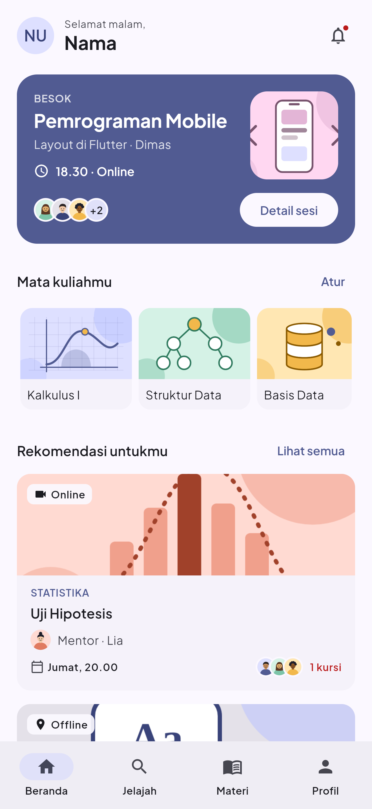
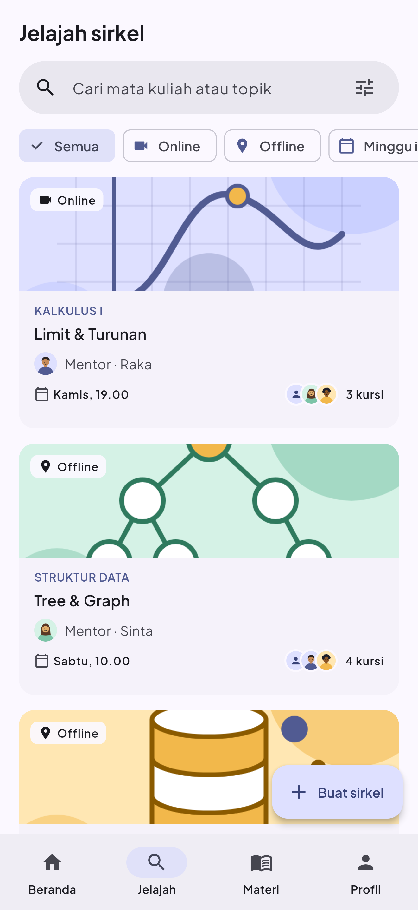
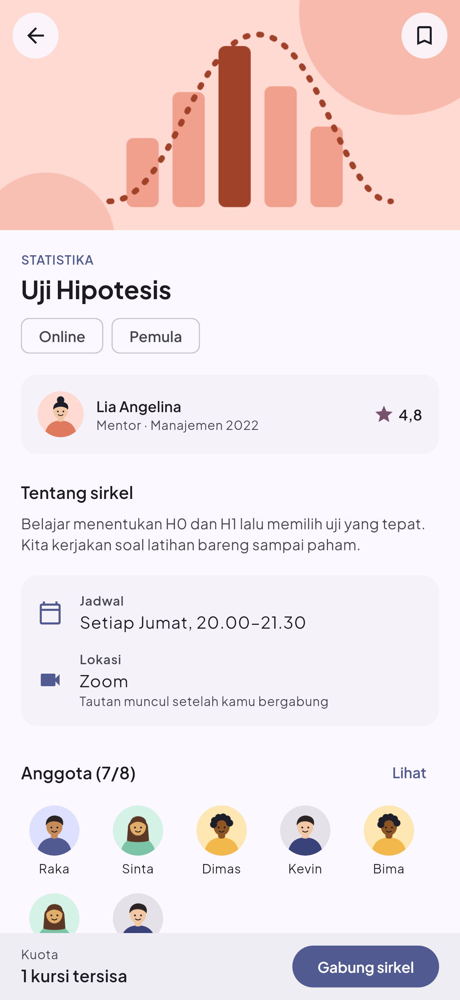
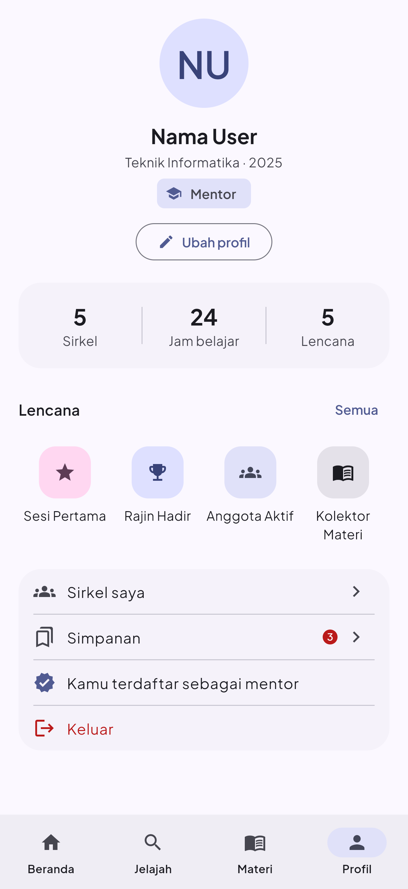
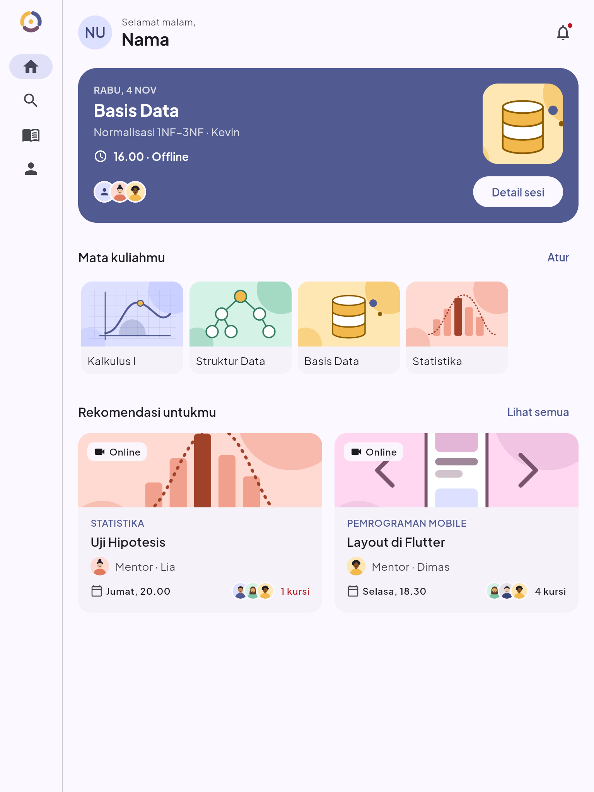
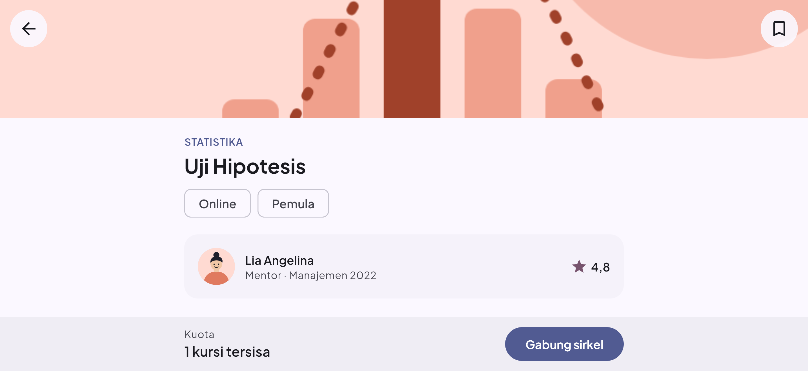
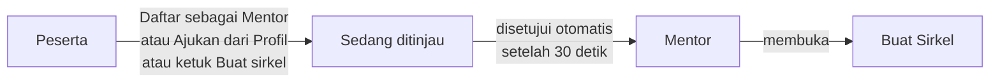

<p align="center">
  
</p>

<h1 align="center">Sirkel</h1>

<p align="center">
  Aplikasi mobile untuk belajar bareng mentor sebaya. Proyek ini mendukung <b>SDG 4: Pendidikan Berkualitas</b>.
</p>

<p align="center">
  
  
  
  
  
</p>

---

## 📖 Tentang Sirkel

Banyak mahasiswa kesulitan di mata kuliah tertentu tapi sungkan bertanya ke dosen. **Sirkel** mempertemukan mereka dengan **kakak tingkat (mentor sebaya)** dalam kelompok belajar kecil yang disebut *sirkel*. Pengguna bisa:

- 🔍 **Menemukan sirkel** sesuai mata kuliah, jadwal, dan mode belajar (online/offline)
- 🤝 **Bergabung dan belajar bareng** mentor sebaya dengan bahasa yang lebih santai
- 📅 **Mengatur jadwal**: sesi dihitung otomatis dari sirkel yang diikuti, lengkap dengan pengingat
- 📚 **Membaca dan menyimpan materi** yang dibagikan mentor
- 🏅 **Memantau progres** lewat statistik dan lencana yang terbuka sesuai aktivitas
- 🎓 **Menjadi mentor** dan membuka sirkel sendiri setelah pengajuan disetujui

> Aplikasi ini berfokus pada **front-end**. Semua data berupa *dummy data* di memori (`lib/data/dummy/`) dan belum terhubung ke backend. Aksi yang membutuhkan server disimulasikan (lihat [Simulasi tanpa backend](#-simulasi-tanpa-backend)).

## 👥 Tim Pengembang

Tim **SirkelKomting**, mata kuliah Mobile Front-End.

| Nama | NIM | Bagian |
|---|---|---|
| Richie Sanjiro | 241110236 | Aset, Splash & Onboarding, Masuk & Daftar, Profil, Lencana, Simpanan |
| Cherish Evangeline | 241110597 | Navigasi adaptif, Beranda, Notifikasi, Sirkel Saya & detail sesi |
| Justin Wisely | 241110868 | Tema Material 3, Jelajah & Filter, Detail Sirkel, Gabung & Keluar sirkel |
| Ethan Wilbert | 241110939 | Lapisan data, Ruang & Detail Materi, Pembaca materi, Buat Sirkel |

### Pembagian task

| Anggota | Task 1 | Task 2 | Task 3 |
|---|---|---|---|
| Richie | Responsif & orientasi autentikasi (dua panel, RichText), validasi & kekuatan sandi | Profil interaktif: lencana dinamis, status mentor, Simpanan (geser hapus & Urungkan) | Pengujian & perbaikan (`auth_test.dart`) |
| Cherish | Navigasi adaptif & Beranda (carousel, kartu sesi, sheet detail sesi) | Notifikasi (filter kategori, geser tandai dibaca) & jadwal Sirkel Saya dinamis | Pengujian & perbaikan (`shell_test.dart`) |
| Justin | Responsif & orientasi Jelajah dan Detail Sirkel, tema Material 3 | Pencarian, filter, urutan & riwayat; gabung (deteksi jadwal bentrok) & keluar sirkel | Pengujian & perbaikan (`jelajah_test.dart`) |
| Ethan | Lapisan data dinamis: jadwal, notifikasi otomatis, persetujuan mentor | Pembaca materi, Detail Materi responsif, Buat Sirkel khusus mentor | Pengujian & perbaikan (`buat_sirkel_test.dart`) |

## 📱 Tampilan

| Beranda | Jelajah | Detail Sirkel | Profil |
|---|---|---|---|
|  |  |  |  |

| Tablet | HP landscape |
|---|---|
|  |  |

## ✨ Fitur

### Akun
| Fitur | Keterangan |
|---|---|
| **Splash & Onboarding** | Tiga halaman pengenalan bergambar dengan indikator halaman, tombol Lewati, dan tata letak landscape |
| **Masuk** | Validasi email kampus (`.ac.id`) dan kata sandi, sheet **Lupa kata sandi**, teks "Daftar" yang bisa diketuk (RichText) |
| **Daftar** | Nama, email, program studi, kata sandi dengan **indikator kekuatan** (lemah/sedang/kuat dari 4 kriteria), pilihan peran Peserta/Mentor, persetujuan ketentuan |
| **Dua panel** | Di layar lebar (≥ 840 px), Masuk dan Daftar tampil berdampingan dengan panel identitas aplikasi |

### Belajar
| Fitur | Keterangan |
|---|---|
| **Beranda** | Sapaan, kartu sesi terdekat, carousel mata kuliah (bisa diatur), rekomendasi sirkel, lonceng dengan badge belum dibaca |
| **Jelajah** | Pencarian langsung, chip cepat (Online, Offline, Minggu ini), sheet Filter (mata kuliah, mode, hari, kursi tersisa), **urutkan** (paling sesuai, jadwal terdekat, kursi terbanyak, rating mentor), dan **riwayat 5 pencarian terakhir** |
| **Detail Sirkel** | Info mentor, jadwal & lokasi, anggota, simpan, gabung dengan **peringatan jadwal bentrok**, keluar sirkel dengan konfirmasi; tombol bawah menyesuaikan status (mentor/anggota/belum gabung) |
| **Sirkel Saya** | Kalender per minggu dan daftar sesi 14 hari ke depan yang dihitung dari sirkel yang diikuti; tab daftar sirkel |
| **Detail sesi** | Waktu, lokasi, salin tautan; "Masuk sesi" aktif 15 menit sebelum mulai sampai sesi selesai, status "Sedang berlangsung", dan "Lihat lokasi" untuk sirkel offline |
| **Materi** | Ruang materi berfilter mata kuliah, Detail Materi, **pembaca materi** (PageView tersinkron dengan CarouselView), penanda tersimpan di kartu |
| **Buat Sirkel** | **Khusus mentor yang sudah disetujui.** Pilih sampul, mata kuliah, judul, mode, hari, jam (time picker), dan kuota |

### Progres & kabar
| Fitur | Keterangan |
|---|---|
| **Notifikasi otomatis** | Pengingat sesi terdekat, kabar gabung, sirkel diterbitkan, pengajuan dan persetujuan mentor; **filter kategori** (Semua, Sesi, Sirkel, Akun) dengan jumlah belum dibaca dan **geser untuk tandai dibaca** |
| **Profil** | Avatar (inisial untuk akun baru), statistik, ubah profil, status mentor, keluar akun |
| **Lencana dinamis** | 6 lencana dengan syarat yang dihitung dari aktivitas (sirkel diikuti, jam belajar, materi & sirkel disimpan, status mentor), progres "3/4", urutan otomatis, dan sheet detail |
| **Simpanan** | Sirkel dan materi yang disimpan (terakhir disimpan di atas); **geser untuk hapus** dengan **Urungkan** ke posisi semula |

### Status mentor



| Status | Saat mengetuk "Buat sirkel" |
|---|---|
| Peserta | Dialog "Khusus mentor" dengan tombol **Ajukan jadi mentor** |
| Sedang ditinjau | Dialog "Pengajuan sedang ditinjau"; form tidak terbuka |
| Mentor | Form Buat Sirkel terbuka |

## 🧪 Simulasi tanpa backend

| Aksi | Yang terjadi di aplikasi |
|---|---|
| Kirim tautan Lupa kata sandi | Email divalidasi, lalu SnackBar "tautan terkirim" |
| Masuk sesi / Lihat lokasi | SnackBar "Membuka …" (tanpa membuka aplikasi rapat atau peta) |
| Peninjauan pengajuan mentor | Disetujui otomatis **30 detik** setelah diajukan, lalu muncul notifikasi |
| Data (gabung, simpan, notifikasi, profil) | Tersimpan di memori selama aplikasi berjalan; kembali ke awal setelah aplikasi dijalankan ulang |

## 📐 Responsif & orientasi

| Lebar layar | Navigasi | Tata letak |
|---|---|---|
| < 600 px (HP) | `NavigationBar` di bawah, tombol Buat sirkel di Jelajah | Grid sirkel 1 kolom, grid materi 2 kolom |
| 600–839 px (tablet) | `NavigationRail` di kiri, tombol Buat sirkel di rail | Grid sirkel 2 kolom, materi 3 kolom |
| ≥ 840 px (desktop) | `NavigationRail` di kiri, tombol Buat sirkel di rail | Grid sirkel 3 kolom, materi 4 kolom, Masuk/Daftar dua panel |

Di **HP landscape** (lebar besar tetapi tinggi < 600 px), header Detail Sirkel dipendekkan, ilustrasi dialog disembunyikan, dan thumbnail pembaca materi disembunyikan agar konten tetap terbaca. Ukuran yang diuji: 360×800, 932×430, 768×1024, dan 1280×800.

## 🧩 Materi pertemuan 1–7 di proyek ini

| Materi | Contoh penerapan |
|---|---|
| Scaffold & widget dasar | Semua layar; `Text`, `Icon`, `Image.asset`, `CircleAvatar` (`UserAvatar`) |
| RichText | Teks "Daftar" yang bisa diketuk, notifikasi dengan bagian tebal (`Text.rich`) |
| Reusable widget | `SirkelCard`, `MateriCard`, `UserAvatar`, `InfoRow`, `EmptyState`, `CoverImage`, `SectionHeader` |
| Material 3 | `ColorScheme.fromSeed`, `SegmentedButton`, `FilterChip`/`ChoiceChip`/`InputChip`, `Badge.count`, `SearchBar`, `CarouselView`, `NavigationBar`/`NavigationRail`, `showTimePicker`, `LinearProgressIndicator` |
| Layout single-child | `Container`, `Padding`, `SizedBox`, `Center`, `Align`, `ConstrainedBox` |
| Layout multi-child | `Row`, `Column`, `Stack` + `Positioned`, `Wrap`, `ListView`, `GridView`/`SliverGrid`, `PageView`, `Expanded`, `OverflowBar`, `Dismissible` |
| Responsif | `MediaQuery`, `LayoutBuilder`, breakpoint 600/840, orientasi, konten dan sheet dengan lebar maksimum di layar lebar |

## 🛠️ Teknologi

- **Flutter** 3.47 dan **Dart** 3.13
- **Material 3** dengan tema kustom (seed `#4355B9`)
- Font **Plus Jakarta Sans** (lisensi OFL)
- Tanpa package pihak ketiga, hanya `cupertino_icons`
- Pengujian dengan `flutter_test` (unit dan widget test)

## 🚀 Cara Menjalankan

**Prasyarat:** Flutter SDK 3.47+ sudah terpasang. Cek dengan `flutter doctor`.

```bash
git clone https://github.com/Rolexx17/SirkelKomting.git
cd SirkelKomting
flutter pub get
flutter run
```

Pilih device saat diminta: emulator Android, HP lewat USB, Chrome, atau Windows. Di Chrome, gunakan **mode perangkat** (F12 → Ctrl+Shift+M) agar tampilan HP terlihat.

**Akun demo:** aplikasi dibuka sebagai *Nadia Putri* (peserta). Daftar akun baru untuk mencoba alur dari awal.

> Data disimpan di variabel `static`. Setelah mengubah kode di `lib/data/`, hentikan aplikasi lalu jalankan ulang (bukan *hot reload*). Bila tampilan terlihat versi lama, jalankan `flutter clean` lalu `flutter pub get`.

## ✅ Pengujian

```bash
flutter analyze   # No issues found!
flutter test      # +143: All tests passed!
```

| File test | Pemilik | Jumlah | Yang diuji |
|---|---|---|---|
| `test/auth_test.dart` | Richie | 34 | Onboarding, validasi Masuk/Daftar, kekuatan sandi, Lupa sandi, dua panel, ubah profil, Keluar, pengajuan mentor, lencana dinamis, Simpanan (geser hapus & Urungkan) |
| `test/shell_test.dart` | Cherish | 32 | Navigasi adaptif, regresi tab basi, badge notifikasi, carousel Beranda, avatar inisial, waktu sesi, sheet detail sesi, Sirkel Saya, filter & geser Notifikasi |
| `test/jelajah_test.dart` | Justin | 42 | Pencarian & filter, urutan hasil, riwayat pencarian, "Minggu ini", jadwal bentrok, Detail Sirkel, header & dialog per orientasi, simpan, keluar sirkel |
| `test/buat_sirkel_test.dart` | Ethan | 35 | Breakpoint responsif, jadwal dinamis, notifikasi otomatis, status & persetujuan mentor, simpanan, akses Buat Sirkel khusus mentor, Pembaca materi |

Setiap test memanggil `DummyData.resetUntukTes()` di `setUp`, jadi data selalu mulai dari kondisi awal. Fungsi yang bergantung pada waktu menerima tanggal sebagai parameter (misalnya `jadwalSesiSejak`, `notifikasiSejak`, `statusMentorSejak`), sehingga hasil test tidak bergantung pada jam saat test dijalankan.

## 📁 Struktur Folder

```
lib/
├── main.dart              # Entry point
├── app.dart               # SirkelApp: tema dan konfigurasi route
├── core/
│   ├── constants/         # AppAssets, AppSizes, AppStrings
│   ├── theme/             # Tema Material 3
│   └── utils/             # Helper responsif (breakpoint 600/840)
├── data/
│   ├── models/            # AppUser, Sirkel, Materi, Notifikasi, Sesi, Lencana
│   ├── util/              # Parser hari & jam, label tanggal sesi
│   └── dummy/             # Data contoh di memori + fungsi pengubah data
├── features/              # Satu folder per fitur
│   ├── splash/  onboarding/  auth/      profil/
│   ├── shell/   beranda/     notifikasi/ sirkel_saya/
│   ├── jelajah/ sirkel/
│   └── materi/  buat_sirkel/
├── routes/                # Named routes terpusat (AppRoutes)
└── shared/widgets/        # Widget reusable (SirkelCard, MateriCard, UserAvatar, dll.)

assets/                    # Logo, ilustrasi, avatar, sampul, font
docs/screenshots/          # Gambar untuk README
test/                      # auth, shell, jelajah, buat_sirkel
```

Setiap fitur menyimpan teksnya di file `*_strings.dart`, warna diambil dari `Theme.of(context).colorScheme`, dan ukuran dari `AppSizes` (atau konstanta privat bernama di file fitur), sehingga teks dan kode warna tidak ditulis langsung di widget.

## 🌿 Alur Git

- `main`: versi stabil (yang dikumpulkan)
- `dev`: tempat menggabungkan pekerjaan anggota
- Perubahan masuk ke `main` lewat Pull Request dari `dev`, setelah `flutter analyze` dan `flutter test` bersih

## 📄 Lisensi

Dirilis di bawah [MIT License](LICENSE). Font Plus Jakarta Sans menggunakan [SIL Open Font License](assets/fonts/OFL.txt).
